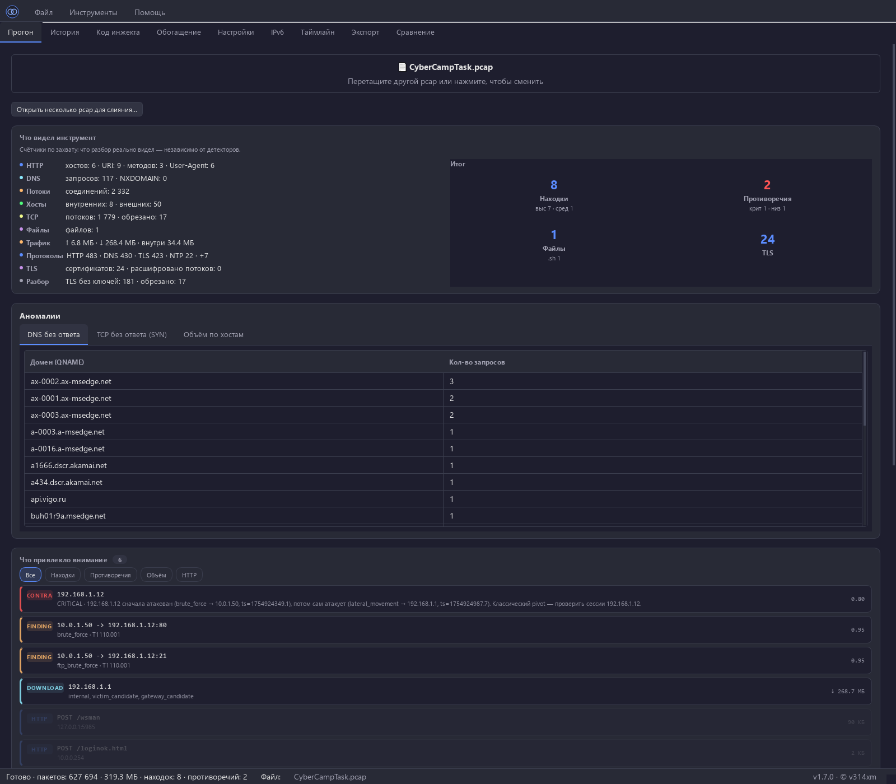

# Paradox

[](#tests)
[](https://www.python.org/downloads/)
[](LICENSE)

**Offline PCAP triage with a contradiction layer: 30 detectors, 13 cross-source
rules, CLI and GUI.**

[Русский](README.md) · **English**

Paradox does not stop at a list of findings. It compares what different layers
of the capture say about the same host and reports where they disagree: DNS vs
SNI, JA3 vs User-Agent, MAC vs IP, assigned role vs observed behaviour. A
workstation that starts serving HTTP and a victim that also attacks are not
"more findings" — they are contradictions, and they are usually the fastest way
to a pivot host.



Docs: [operations manual](docs/OPERATIONS.md) · [architecture](ARCHITECTURE.md) ·
[module reference](MODULES.md) · [security model](SECURITY.md) · [roadmap](TODO.md)
(deep-dive docs are in Russian for now).

---

## Quick start

```bash
# 1. Install (Python 3.11+)
pip install -e ".[gui]"

# 2. Analyse a capture — writes JSON + Markdown to reports/
paradox capture.pcap

# 3. Open the GUI (optional)
python -m paradox_gui
```

A Windows installer (`Paradox-<version>-setup.exe`) is on the
[releases page](https://github.com/v314xm/paradox/releases). The binary is
**not code-signed**, so SmartScreen will warn on first launch; `SHA256SUMS` is
published next to it.

### Did it work?

A successful run exits with code `0` and prints the report paths. Check three
things:

1. `reports/<name>.report.json` and `reports/<name>.report.md` exist.
2. `provenance.pcap_sha256` in the JSON matches your file.
3. `summary` has non-zero packet/flow counters. An empty `findings` list on a
   quiet capture is normal; empty counters are not — look at
   `summary.extractor_errors`.

Exit codes: `0` success, `2` file not found, `3` input is not a pcap (or is
`.pcapng` — convert with `editcap -F pcap in.pcapng out.pcap`). Exit code `1`
means a Python traceback: that is a bug, please open an issue.

---

## CLI

```bash
paradox capture.pcap                          # JSON + Markdown into reports/
paradox capture.pcap -o reports/today.json    # exact file
paradox capture.pcap -o reports/              # directory
paradox capture.pcap --enrich                 # threat intel (needs network)
paradox capture.pcap --stix                   # + STIX 2.1 bundle
paradox capture.pcap --html                   # + self-contained HTML report
paradox capture.pcap --behavioral             # + Isolation Forest layer
paradox capture.pcap --tls-keylog keys.log    # decrypt TLS via SSLKEYLOGFILE
paradox capture.pcap --plugins                # detectors from ~/.paradox/plugins
paradox capture.pcap --lang en                # English report and CLI messages
paradox --version
```

Without a path, `paradox` asks for one interactively.

| Flag | Network | What it adds |
|---|---|---|
| *(none)* | no | JSON + Markdown |
| `--lang en` | no | report and CLI messages in English (default is `ru`) |
| `--enrich` | **yes** | Shodan/AbuseIPDB/VT/… verdicts for IOCs |
| `--stix` | no | STIX 2.1 bundle for sharing |
| `--html` | no | standalone HTML (print to PDF) |
| `--behavioral` | no | session/host statistical anomalies |
| `--tls-keylog` | no | decrypted HTTP/2 and HTTPS/1.1 objects |
| `--plugins` | no | your own detectors — **arbitrary Python** |

Outputs next to the JSON: `.md` always, `.stix.json` / `.html` on request. IOC
files (`iocs.txt`, `iocs.csv`, `iocs.json`, `suricata.rules`, `queries.txt`)
are always written to `output_dir` (`reports/` by default), even when `-o`
points elsewhere.

---

## What it finds

| Area | Examples |
|---|---|
| Victim profile | IP, MAC, hostname, username, realm from ARP/DHCP/NBNS/Kerberos |
| C2 infrastructure | DGA, cloud tunnels, typosquatting, IP-check services, SNI without DNS, malware JA3/JA3S |
| Beaconing | jitter + multi-tenant filter, separate slow mode for >1 h sleep |
| DNS tunneling | long unique labels under one base domain |
| Active recon | port/web scanners, SSH/FTP brute force |
| Lateral movement | SMB, RDP, WinRM between internal hosts |
| Exfiltration | 100 MB+ transfers, reverse asymmetry, binary POST series |
| Payloads | downloaded scripts/PHP, webshells, command injection, gzip/deflate bodies |
| Web shells | `php_download`, `webshell_upload`, WSO/b374k/c99/r57 markers |
| HTTP/2 & TLS | h2c always; h2/HTTPS with `SSLKEYLOGFILE` (HPACK, multiplexing, pairing) |
| AD attacks | Kerberoasting, ADRecon, DCSync (DRSUAPI), SMB2/LDAP/DCE-RPC parsing |
| YARA | optional scan of carved files |

### Contradictions (13 rules)

| Rule | Severity | What it catches |
|---|---|---|
| `victim_makes_attack` | critical | Host is both victim and attacker → pivot |
| `mac_ip_conflict` | critical | ARP spoofing: two MACs on one IP |
| `sni_host_mismatch` | high | Domain fronting: SNI ≠ HTTP Host |
| `ja3_ua_mismatch` | high | Tool JA3 + browser UA → script mimicry |
| `port_service_mismatch` | high | TLS on 22, HTTP on 445 → tunnel |
| `role_deviation` | high/critical | Behaviour contradicts OUI role: workstation serving web, server scanning |
| `reverse_asymmetry` | medium | 10:1 session ratio |
| `direct_ip_no_dns` | medium | Client talks to an IP with no DNS resolution |
| `sni_without_dns` | medium | SNI with no DNS answer in the capture |
| `dns_answer_mismatch` | medium | SNI ≠ resolved IP (CNAME-aware) |
| `sni_cert_mismatch` | medium | SNI ≠ certificate CN/SAN |
| `self_signed_cert` | medium | Self-signed certificate on an external host |
| `expired_cert` | low | Expired certificate |

Every finding and contradiction ships with a plain-language explanation: what
happened, why it matters, what to check next, and where the detector can be
wrong. The same text goes to JSON, Markdown (`## Interpretation`) and the GUI.

---

## GUI

Nine tabs: Run, History, Payload, Enrichment, Settings, IPv6, Timeline, Export,
Compare.

- **Run** — drag-and-drop a pcap, summary tiles, findings with an action column
  that drills into the selected row, observations, anomalies, priority cards.
- **Payload** — excerpts of the bodies that triggered a detector: URL → Base64
  → Gzip chain, hex pages, multipart parts, IOC inspector, safe deobfuscation,
  Markdown export with secrets redacted. Nothing is executed; the preview is a
  sanitized static render. `Ctrl+Shift+P` opens it as a separate window.
- **Explanation** — a separate window with the full finding/contradiction
  narrative, alternatives and a beginner section.
- **Compare** — diff two JSON reports.
- **Settings** — 13 Config sections, profiles (Default/CTF/Corporate), detector
  and rule toggles, plugin directory, Threat Intel keys (keyring).

The GUI never modifies the core: it calls `run_pipeline` in a `QThread` with
`detectors`/`rules` parameters.

---

## Performance

`CyberCampTask.pcap` — 334 MB, 627 694 packets: **14.4 s**, 8 findings,
4 contradictions (Windows, single core, 2026-11-11). The gains came from a
custom pcap reader, struct-based header parsing, a `slots` packet record and an
early exit for pure ACKs — not from skipping work.

---

## Install from source

```bash
pip install -e ".[dev,gui]"            # development + GUI
pip install -e ".[dev,gui,yara,enrich]"  # + YARA + threat intel
pre-commit install                      # optional
```

Requirements: Python 3.11+, `scapy>=2.5`, `pyyaml>=6.0`, `cryptography>=42`
(TLS decryption), `hpack>=4.0` (HTTP/2); `PySide6` for the GUI, `yara-python`
and `keyring` optional.

---

## Tests

```bash
pytest -m "not slow"    # ~27 s, 1656 passed
ruff check paradox tests paradox_gui tools
```

1656 tests in 186 files. CI runs ruff and `pytest -m "not slow"` on Ubuntu
(`.github/workflows/ci.yml`). On Windows a full run may exit with
`0xC0000005` **after** all tests (pytest/PySide6 shutdown bug); read the result
from `--junitxml`, not from the exit code.

Core coverage 87.1%, GUI 67.6% (`tools/coverage_gate.py`).

---

## Limitations

- Built and tested on Windows first; sources run on Linux/macOS, the installer
  is Windows-only.
- TLS 1.3 certificates are encrypted — certificate rules work on TLS 1.2 only.
- HTTP/2 over TLS needs a keylog file; without it you see flows, not objects.
- brotli and zstd bodies are not decompressed (gzip/deflate are).
- SMB1 and SMB3 encryption are not parsed; they appear in `smb2_parse_errors`.
- Reassembly budget is 200 MB; streams beyond it are marked truncated.
- Plugins execute arbitrary Python with your user's rights — disabled by
  default (`plugins_enabled=False`).
- The Windows binary is unsigned.

---

## License

MIT — see [LICENSE](LICENSE).
