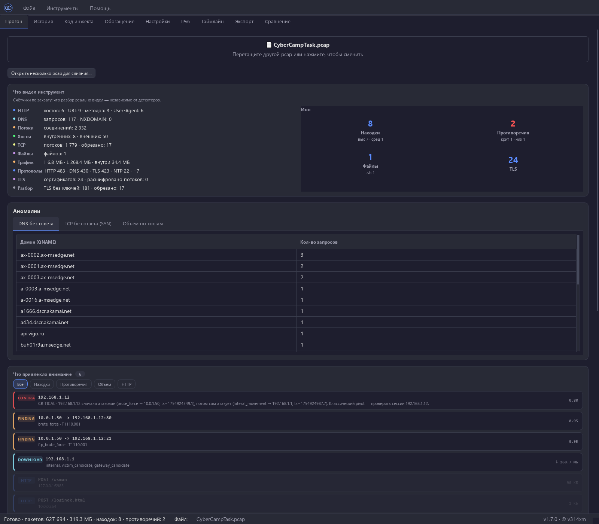

# Paradox

[](#тесты)
[](https://www.python.org/downloads/)
[](LICENSE)
[](https://github.com/astral-sh/ruff)

**PCAP triage: 24 детектора, 12 правил противоречий, GUI, 1303 теста.**

Инструмент для оффлайн-разбора pcap. Ищет **противоречия между слоями данных** — DNS vs SNI, JA3 vs User-Agent, MAC vs IP, роли vs поведение. Показывает не только findings, но и то, что из них не сходится: pivot-хосты, ARP-spoof, domain-fronting, протокольные туннели.



Эксплуатация — [docs/OPERATIONS.md](docs/OPERATIONS.md) · безопасность и модель
доверия — [SECURITY.md](SECURITY.md) · сайт — [paradoxtool.ru](https://paradoxtool.ru).

## Чем отличается

Zeek, Arkime, tshark, Rita — сотни инструментов парсят pcap и находят то же: DNS-запросы, TLS-хендшейки, HTTP. **Никто не проверяет согласованность между слоями.**

Paradox строит из pcap атомарные факты о мире:

```text
(192.168.1.12, victim_of, 10.0.1.50, ts, 0.85)
(192.168.1.12, attacker_of, 192.168.1.1, ts, 0.80)   ← pivot
(192.168.1.5,  has_mac,   00:60:6e:00:9d:f9, ts, 0.90)
(192.168.1.5,  has_mac,   aa:bb:cc:dd:ee:02, ts, 0.60) ← ARP-spoof
```

И ищет противоречия. Это новый слой анализа — поверх findings и поверх entities.

## Быстрый старт

```bash
pip install -e ".[gui]"

paradox capture.pcap          # CLI → JSON + Markdown
python -m paradox_gui         # GUI
```

Python 3.11+. Исходники запускаются на Windows / Linux / macOS;
готовый установщик пока только для Windows.

Готовый `.exe` — в [Releases](https://github.com/v314xm/paradox/releases).
Windows: установка, обновление, удаление, где лежат данные — [docs/OPERATIONS.md](docs/OPERATIONS.md).

### Пример вывода

```text
packets:              627 694
unique DNS queries:   117
NXDOMAIN count:       0
flows:                2 328
findings:             7
contradictions:       2
report JSON:          reports/CyberCampTask.report.json
report Markdown:      reports/CyberCampTask.report.md
```

В Markdown — TL;DR в порядке kill-chain:

```text
PIVOT: 192.168.1.12 (жертва brute_force, но сама атакует 192.168.1.1 через WinRM).
Payload: /ftp_update.sh (sh, 4 KB, sha256 a1b2c3…).
Timeline: port_scan → ftp_brute_force → command_injection → beaconing → large_transfer.
```

## Что делает

Из одного pcap:

- **Профиль жертвы.** IP, MAC, hostname, username, realm — из ARP, DHCP, NBNS, Kerberos.
- **C2-инфраструктура.** DGA, cloud tunnels, typosquatting, IP-check сервисы, SNI без DNS, malware-JA3/JA3S.
- **C2-beaconing.** Периодические heartbeat-соединения (jitter < 0.1, ≥ 20 обращений, ≥ 10 минут) + multi-tenant filter против CDN. Отдельный slow-режим — для C2 со sleep больше часа.
- **DNS tunneling.** Длинные уникальные поддомены под одним базовым доменом.
- **Активная разведка.** Web/port-сканеры, SSH/FTP-брутфорс.
- **Lateral movement.** WinRM, PsExec, SMB, RDP между внутренними хостами.
- **Эксфильтрация.** Large transfers (100 МБ+) + reverse asymmetry (10:1 при объёме ≥ 1 МБ) + серии бинарных POST'ов на внешний хост.
- **Payload download.** Скрипты, установщики, PHP-исходники из HTTP. Metadata-only, тело на диск не пишется. gzip/deflate-тела распаковываются перед поиском паттернов.
- **Веб-шеллы.** `php_download` — ответ начинается с `<?php`; `webshell_upload` — POST с `<?php` в теле.
- **RCE в HTTP.** Command injection в URI и POST body на полных HTTP-объектах после TCP reassembly. HTTP keep-alive и pipelining разбираются полностью — все сообщения соединения, не только первое.
- **YARA.** Сканирование вырезанных файлов пользовательскими правилами.
- **Роли хостов.** `domain_controller`, `victim_candidate`, `attacker_candidate`, `c2_candidate`, `gateway_candidate`, `pivot`.
- **Timeline / kill-chain.** Хронология findings и противоречий по фазам (recon → initial_access → execution → lateral_movement → c2 → exfiltration).

## Противоречия (12 правил)

| Правило | Severity | Что находит |
|---|---|---|
| `victim_makes_attack` | critical | Хост одновременно жертва и атакующий → pivot |
| `mac_ip_conflict` | critical | ARP-spoof: два MAC на одном IP |
| `sni_host_mismatch` | high | Domain fronting: SNI ≠ HTTP Host |
| `ja3_ua_mismatch` | high | JA3 tool + browser UA → мимикрия скрипта |
| `port_service_mismatch` | high | TLS на 22, HTTP на 445 → туннель |
| `reverse_asymmetry` | medium | Пропорция сессии 10:1 (эксфильтрация) |
| `direct_ip_no_dns` | medium | Клиент ходит на IP без DNS-резолва |
| `sni_without_dns` | medium | SNI без DNS-ответа в захвате |
| `dns_answer_mismatch` | medium | SNI не совпадает с резолвнутым IP (CNAME-aware) |
| `sni_cert_mismatch` | medium | SNI ≠ CN/SAN сертификата |
| `self_signed_cert` | medium | Самоподписанный сертификат на внешнем ресурсе |
| `expired_cert` | low | Просроченный сертификат |

## GUI

9 вкладок: Прогон / История / Код инжекта / Обогащение / Настройки / IPv6 / Таймлайн / Экспорт / Сравнение.

- **Прогон** — drop zone, прогресс по фазам, summary, findings с фильтрами, противоречия, «Граф связей», «Файлы» (carved), What-If (исключить IP/домен → пересчитать).
- **История** — все прогоны сессии, клик → детали.
- **Код инжекта** — выдержки тел, на которых сработали детекторы инъекций и веб-шеллов: цепочка декодирования URL → Base64 → Gzip/Deflate, подсветка sinks/источников, hexdump для бинаря и статический предпросмотр разметки без исполнения. Окно `Ctrl+Shift+P` — для второго монитора.
- **Обогащение** — Threat Intel по выбранным IOC.
- **Настройки** — 13 секций Config с тултипами, профили (Default/CTF/Corporate), отключение детекторов и правил, секция «Плагины» (включение, каталог, проверка загрузки).
- **IPv6** — NDP-соседи, роутеры.
- **Таймлайн** — kill-chain фазы с фильтрами.
- **Экспорт** — CSV findings, STIX 2.1 bundle и самодостаточный HTML-отчёт (печать в PDF из браузера).
- **Сравнение (B1)** — два JSON-отчёта → что добавилось / исчезло / изменилось. Для повторного триажа одного и того же pcap через день/неделю.

### Сравнение прогонов (B1)

```bash
paradox FIN-2015.pcap          # вчера
paradox FIN-2015.pcap          # сегодня
```

GUI → «Сравнение» → загрузить `old.json` + `new.json`:

```text
Findings: +2 −1 ~0 · Противоречий: +1 −0 · packets: 100→150 (+50)

  Новые findings (2)
    beaconing           10.0.0.5 → 1.2.3.4:443
    ja3_malware         Cobalt Strike (ja3=a0e9f5d6…)
  Исчезли findings (1)
    dga_domain          xk7f2n9p.com
  Новые противоречия (1)
    victim_makes_attack 192.168.1.12  critical
```

## CLI

```bash
paradox capture.pcap                          # JSON + Markdown в reports/
paradox capture.pcap -o reports/today.json    # конкретный путь
paradox capture.pcap --enrich                 # + Threat Intel
paradox capture.pcap --stix                   # + STIX 2.1 bundle
paradox capture.pcap --html                   # + HTML-отчёт (печать в PDF)
paradox capture.pcap --plugins                # + детекторы из ~/.paradox/plugins
paradox capture.pcap -o reports/              # директория
```

Выход:

- `reports/<pcap>.report.json` — полный отчёт (schema_version, provenance, contradictions)
- `reports/<pcap>.report.md` — TL;DR, timeline, findings, IOC
- `reports/<pcap>.report.stix.json` — STIX 2.1 bundle (с `--stix`)
- `reports/<pcap>.report.html` — самодостаточный HTML-отчёт (с `--html`)
- `reports/iocs.txt` `iocs.csv` `iocs.json` `suricata.rules` `queries.txt` — IOC-экспорт

Коды выхода, лимиты pcap и RAM, где лежат данные и что делать при пустом
отчёте — [docs/OPERATIONS.md](docs/OPERATIONS.md).

## Производительность

| Размер | Пакетов | Время |
|---|---|---|
| 152 МБ | 232k | 12 сек (с TCP reassembly) |
| 334 МБ | 627k | 23–28 сек |
| 4.7 ГБ (58 файлов) | 9.5M | 10 мин полный батч |

Память — ~106 МБ на 334 МБ файл.

В основе — собственный парсер пакетов на `struct.unpack`, без scapy dissect. 39× ускорение против чистого scapy. Scapy используется точечно — только для сложных payload.

## Архитектура

```text
PCAP → Extractors → CaptureState → Detectors → Findings
                                            ↓
                           ContradictionDetector
                              (Fact extraction)
                                            ↓
                              ContradictionRules
                                            ↓
                                Contradictions
                                            ↓
                             Timeline / kill-chain
                                            ↓
                                 build_entities
                                  (роль pivot)
                                            ↓
                            Reporters → JSON + MD + IOC
```

Timeline строится после contradictions (нужны оба источника), до `build_entities` (pivot — это «жертва + атакующий», роль вычисляется по contradictions).

## Что внутри

| Слой | Модуль | Кол-во |
|---|---|---|
| Extractors | flow, dns, tls, http, host_identity, arp_history, dhcp, nbns, kerberos, ndp, ssh_banner, smtp | 12 |
| Post-extract | reassembler, http_object, tls_cert, file_carve | 4 |
| Detectors | DGA, port_scan, suspicious_port, nxdomain_burst, cloud_tunnel, ip_check_service, typosquatting, sni_mismatch, ja3_malware, ja3s_malware, brute_force, ftp_brute_force, ssh_brute_force, smtp_spam, beaconing, dns_tunneling, lateral_movement, large_transfer, vulnerable_path, command_injection, http_binary_upload, php_payload, webshell_markers, yara | 24 |
| Contradictions | см. таблицу выше | 12 |
| Analyzers | absence, counterfactual (What-If), story, ndp | 4 |
| Reporters | JSON, Markdown, flow report, IOC (txt/csv/json/suricata/kql), HTML, STIX 2.1 | 6 |
| Enrichment (опционально) | Shodan InternetDB, AbuseIPDB, VirusTotal, GreyNoise, AlienVault OTX, URLScan, URLhaus, MalwareBazaar, ThreatFox | 9 |

MITRE ATT&CK маппинг для всех findings.

## Тесты

```bash
pytest -m "not slow"           # ~25 сек, 1303 passed
ruff check paradox tests paradox_gui tools
```

1303 теста в 154 файлах. CI-workflow в репозитории пока нет — тесты гоняются локально.
На Windows полный прогон может завершиться кодом `0xC0000005` уже после
всех тестов (баг выхода pytest/PySide6); результат считайте по
`--junitxml`, а не по коду возврата.

Покрытие:

- Парсеры (TLS, X.509 DER, Kerberos, NBNS, HTTP, IPv6)
- Все 12 extractors
- Все 24 детектора + MITRE-map
- Все 12 правил contradictions
- Reassembler, HTTPObject (keep-alive, gzip/deflate), JA3/JA3S, YARA
- Регрессионные тесты на реальные FP (`test_regressions.py`, 42 теста)
- B1 diff (`test_run_diff.py`, 10 тестов)
- Config, GUI smoke-тесты

## Проверено на

- **FIRST-2015 Hands-on Network Forensics** — 58 pcap, 9.5M пакетов, 4.7 ГБ, 10 минут. 386 findings, 11 contradictions, 0 ошибок.
- **CTF CyberCampTask** — 334 МБ, 627k пакетов. 7 findings, 2 contradictions, 0 FP. Pivot-правило находит 192.168.1.12.
- **MTA 2025-06-13** — malware-traffic-analysis.net. 10 findings (4 typosquatting, 3 бинарные выгрузки, 2 lateral movement, 1 cloud tunnel), 2 contradictions. Профиль жертвы 5/5 (IP, MAC, hostname, username, realm).

## Установка

```bash
# Разработка с GUI
pip install -e ".[dev,gui]"

# + YARA + Threat Intel
pip install -e ".[dev,gui,yara,enrich]"

# Pre-commit (один раз)
pre-commit install
```

## Конфигурация

Всё через `Config` (frozen dataclass) или через GUI «Настройки»:

- Пороги детекторов (beaconing jitter, nxdomain window, port_scan min_dsts)
- Allowlist (CDN, DoH, Windows Update)
- Отключение детекторов / правил
- Плагины: `plugins_enabled`, `plugins_dir` (по умолчанию `~/.paradox/plugins`). Плагин — это Python-код с правами пользователя, см. [SECURITY.md](SECURITY.md).
- API-ключи Threat Intel (в keyring, не в JSON)
- Профили: Default / CTF (сниженные пороги) / Corporate (шумные детекторы выключены)

## Требования

- Python 3.11+
- `scapy` ≥ 2.5 (DNS payload и разбор сложных протоколов)
- `pyyaml` ≥ 6.0
- `PySide6` (только для GUI)
- `yara-python` (опционально, для YARA-правил)
- `keyring` (опционально, для API-ключей Threat Intel)

## Roadmap

Полный план с приоритетами, P0/P1 и замерами — [TODO.md](TODO.md).

- **1.5.1 (текущая)** — 24 детектора, 12 правил противоречий, GUI (9 вкладок), 1303 теста.
- **Волна 1 (в 1.5.1) — сделано.** Единая таксономия findings (`taxonomy.py`): один источник правды о ролях, MITRE и фазах. `ParadoxInputError`, `--version` и код выхода 3 вместо трейсбека на битом pcap. Счётчик обрезанных TCP-потоков и лимиты absence/DNS. Одно определение internal/external IP. Воспроизводимая сборка из `Paradox.spec` + `SHA256SUMS`. Осталось: CI-workflow (решение владельца), 4-й код выхода, вынос крупных модулей — см. [TODO.md](TODO.md).
- **1.5.0** — «Код инжекта», 24-й детектор `webshell_markers`, RU/EN-локализация, HTML-отчёт, STIX 2.1, плагины детекторов.
- **Волна 2 — детекция.** `rare_external_ip`, `long_connections`, context-aware `sni_mismatch` без 73 FP на FIN-2015, cross-finding «успешный брутфорс», медленный beaconing на реальном C2. Каждое изменение — с замером на трёх эталонных захватах.
- **Дальше** — волны 3–4 в [TODO.md](TODO.md): stream mode для pcap > 2 ГБ, HTTP/2 (h2-фреймы + HPACK), SMB2/LDAP и AD-детекторы, REST API.

CI-workflow в репозитории нет: пока его не добавят (решение владельца, см. TODO.md), «1303 passed» — локальная цифра.

## Вклад

Issues и pull requests приветствуются.

- Стиль кода — `ruff check paradox tests paradox_gui tools` (0 ошибок обязательно).
- Тесты — обязательны для новых правил и детекторов.
- Pre-commit — `pre-commit install` (ruff + trailing whitespace + eof).
- Комментарии — на русском, объясняют «почему», не «что».

## Лицензия

MIT. См. [LICENSE](LICENSE).
